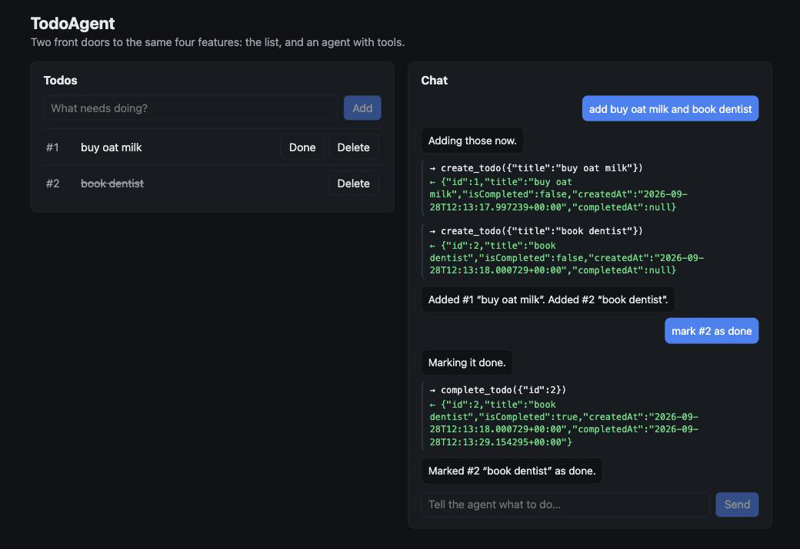
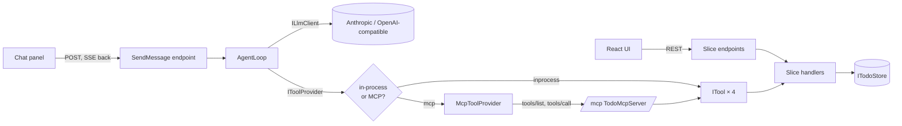

<div align="center">

# TodoAgent

**A todo app with two front doors to the same four features: a React UI, and an AI agent that discovers its tools over MCP.**

[](https://github.com/AdisBacic/TodoAgent/actions/workflows/ci.yml)


<br>



<sub>The step timeline: every tool call and its result, streamed over Server-Sent Events while the agent works.</sub>

</div>

<br>

Type *"add buy oat milk and book dentist"* into the chat and watch the agent call `create_todo` twice, read the results, and confirm in one line. Click **Done** on the list and it is the same handler the agent just used. There is exactly one implementation of every feature; the UI and the agent are two callers of it.

This is a learning project written to be read in order. The README is the book, the git history is its table of contents, and every commit leaves the app runnable and the tests green.

## What's inside

| | |
|---|---|
| **Vertical slices** | `Features/Todos/CreateTodo/` owns its request, validator, handler, endpoint and tests. No MediatR, no repository layer, no project-per-layer. |
| **An agent loop you can read** | `Agent/AgentLoop.cs` is a `while` around a model call: ask, run the tools it asked for, feed the results back, stop on a plain answer or the iteration cap. |
| **Raw LLM calls** | `AnthropicLlmClient` and `OpenAiLlmClient` are `HttpClient` + `System.Text.Json`, the wire formats spelled out. Provider-neutral types in between; nothing outside `Agent/Llm` knows a provider. |
| **Tools over MCP** | `TodoMcpServer` serves the same four tools at `/mcp` with the official C# SDK; `McpToolProvider` consumes any MCP server (HTTP or stdio). Flipping one config value moves the tool calls across a real protocol, and the loop has no diff. |
| **Streaming UI** | The chat endpoint streams `AgentEvent`s as SSE; the React timeline shows `→ create_todo({"title":"buy milk"})` and `← {"id":1,…}` as they happen. |
| **Resume-safe by design** | Every message is persisted the moment it exists. Re-running an interrupted conversation resumes from the last stored tool result instead of restarting. |
| **62 tests, no API key** | A scripted fake model, stubbed HTTP for both adapters, the real SSE endpoint through `WebApplicationFactory`, and an MCP round trip in one process. |

## Quick start

Prerequisites: [.NET 9 SDK](https://dotnet.microsoft.com/download/dotnet/9.0), Node 22.

```bash
git clone https://github.com/AdisBacic/TodoAgent.git && cd TodoAgent

# the model: Anthropic (default) …
dotnet user-secrets set "Llm:Anthropic:ApiKey" "sk-ant-..." --project src/TodoAgent.Api
# … or a local Ollama, no key needed
ollama pull llama3.1 && export Llm__Provider=openai

# API on http://localhost:5080
dotnet run --project src/TodoAgent.Api

# Web on http://localhost:5173 (proxies /api to the API)
cd src/TodoAgent.Web && npm install && npm run dev
```

Then, to serve the agent's tools over MCP instead of in-process (chapter 3):

```bash
Tools__Provider=mcp dotnet run --project src/TodoAgent.Api
```

Tests: `dotnet test`. Without a model key the todo list works and the chat answers with a single `error` event saying what to set. All settings are described under [Configuration](#configuration).

## How it fits together



Three interfaces carry the whole design: `ILlmClient` (which model), `ITool` (what a tool is), `IToolProvider` (where tools come from). The loop depends on nothing else.

## The book

| Chapter | What it adds |
|---|---|
| [0. Why vertical slices](#0-why-vertical-slices) | The shape of the codebase, and what we deliberately do not use |
| [1. A slice, dissected](#1-chapter-1--a-slice-dissected) | Four todo slices and a React list. No AI yet |
| [2. What an agent loop actually is](#2-chapter-2--what-an-agent-loop-actually-is) | `ILlmClient`, `ITool`, `AgentLoop`, streamed to the UI over SSE |
| [Interlude. Tool-calling vs. asking for JSON](#interlude--tool-calling-vs-asking-the-model-for-json) | Why the loop got simpler when we stopped parsing prose |
| [Configuration](#configuration) | Every setting, and where the key goes |
| [3. MCP: the loop doesn't know where tools live](#3-chapter-3--mcp-the-loop-doesnt-know-where-tools-live) | The same tools served over MCP and consumed by an MCP client. One line changes |
| [4. Testing an agent without an API key](#4-testing-an-agent-without-an-api-key) | A scripted fake LLM and what the loop tests actually assert |
| [5. Where to go next](#5-where-to-go-next) | SQLite, auth, external MCP servers, token streaming |
| [6. Optional chapter 4: moving the loop off the request](#6-optional-chapter-4--moving-the-loop-off-the-request) | Background execution, replay, retries |

The chapters mirror the git history: `git log --oneline --reverse` is the same list.

---

## 0. Why vertical slices

Most .NET sample apps are cut horizontally: a `Controllers` folder, a `Services` folder, a
`Repositories` folder, and a `Models` folder. Adding one feature means touching all four, and
reading one feature means jumping between all four. The folders describe *what kind of code*
something is, not *what it does*.

This codebase is cut vertically. A feature is a folder:

```
Features/Todos/CreateTodo/
├── Endpoint.cs    # HTTP in, HTTP out. Knows about routes and status codes.
├── Handler.cs     # The use case. Knows about todos and the store. No HTTP.
├── Request.cs     # The input shape.
└── Validator.cs   # Rules about the input, kept out of the handler body.
```

Everything the `CreateTodo` use case needs is in that folder. Things two slices genuinely
share sit one level up, at the area root: the `Todo` entity and the `ITodoStore` interface.
That is the whole rule:

> A slice owns its request, validation, handler, endpoint and tests. Slices do not reference
> each other. Cross-area sharing goes through the store or the tool, never by importing another
> slice's handler.

### What we are not using, and why

- **No MediatR.** A handler is a class with one method. `Task<TodoResponse> Handle(CreateTodoRequest, CancellationToken)`.
  The endpoint takes the handler from DI and calls it. There is no bus, no pipeline, no
  `IRequest<T>` marker. When you can see what a slice is without a library in the way, you can
  decide later whether a library earns its place.
- **No repository layer.** `ITodoStore` is the one abstraction todos need, and it exists so
  chapter 1 can be in-memory and a later chapter can be SQLite. It is not a generic
  `IRepository<T>`; it has the five methods todos use.
- **No layers.** There is no `Domain` / `Application` / `Infrastructure` split into separate
  projects. One web project, folders by feature. The agent and MCP code live in their own
  folders (`Agent/`, `Mcp/`) because they are not features; they are the machinery features
  plug into.
- **No AI framework.** LLM calls are `HttpClient` plus `System.Text.Json`. The provider wire
  formats are small, and seeing them is the point.

### Where the folders come from

```
src/TodoAgent.Api/
├── Program.cs          # composition root only: DI, endpoints, middleware
├── Features/
│   ├── Todos/          # chapter 1: the four slices, entity, store
│   ├── Chat/           # chapter 2: the SSE endpoint that runs the loop
│   └── Tools/          # chapter 2: one ITool per slice
├── Agent/              # chapter 2: the loop, events, LLM clients
└── Mcp/                # chapter 3: the loop's tools served and consumed over MCP
```

`Program.cs` is deliberately the least interesting file. It is also the only file that knows
about every slice, which makes it the map. Read it first, then read one slice.

## 1. Chapter 1 — a slice, dissected

Four slices: `ListTodos`, `CreateTodo`, `CompleteTodo`, `DeleteTodo`. Each is a folder under
`Features/Todos/`. They share three files at the area root: `Todo.cs` (the entity and its typed
id), `ITodoStore.cs` (the store interface) and `TodoResponse.cs` (the wire shape every slice
returns). `InMemoryTodoStore.cs` is chapter 1's persistence: a dictionary.

### The one diagram that matters

```
HTTP request
    │
    ▼
Endpoint.cs ──── knows: route, status code, Location header
    │  calls handler.Handle(request, ct)
    ▼
Handler.cs ───── knows: the use case, validation, the store
    │  throws ValidationException / NotFoundException on failure
    ▼
ITodoStore ───── knows: nothing about HTTP or use cases
```

The arrows only point down. An endpoint never touches the store; a handler never sees
`HttpContext`. That is what makes chapter 2 possible: a tool can call the same handler the
endpoint calls, and get the same validation and the same errors.

### Walk through `CreateTodo`

1. **`Request.cs`**: `record CreateTodoRequest(string? Title)`. Nullable, because JSON binding
   cannot promise a value. The type tells the truth; the validator enforces the rule.
2. **`Validator.cs`**: a pure static function from request to a dictionary of errors. No
   exceptions, no store. You can read it in ten seconds and test it without a host.
3. **`Handler.cs`**: validate, throw `ValidationException` if there are errors, add to the
   store, map to `TodoResponse`. That is the entire use case.
4. **`Endpoint.cs`**: `MapPost("/", ...)`, call the handler, return `201 Created` with a
   `Location` header. It is registered from `Program.cs` with one line:
   `CreateTodoEndpoint.Map(todos)`.

### Errors without a result type

Handlers throw two exceptions, `ValidationException` and `NotFoundException`, both in
`Features/Shared/`. One endpoint filter (`DomainExceptionFilter`), attached to the `/api/todos`
route group in `Program.cs`, maps them to `400` and `404` problem+json responses. That keeps
every endpoint to three lines and means the agent layer in chapter 2 gets a plain exception
with a readable message it can hand to the model. A filter rather than the global exception
middleware because these are expected outcomes: they should not be logged as crashes.

The trade-off is real: exceptions for expected outcomes are slower and less explicit than a
`Result<T>` type. For four slices with two failure modes, the exception version is shorter and
easier to read. If the slices grow to a dozen failure modes, revisit it.

### Idempotency

`CompleteTodoHandler` treats "complete an already-completed todo" as success and changes
nothing. That is a deliberate contract for chapter 2: a model that retries a tool call, or
calls it twice, cannot corrupt state or get a confusing error. `DeleteTodo` does return `404`
on a missing id; a delete that silently succeeds hides bugs.

### Tests

`tests/TodoAgent.Tests/Features/Todos/` has one class per slice. Each class tests the handler
directly against a real `InMemoryTodoStore` and a `FixedTimeProvider`, then tests the endpoint
through `WebApplicationFactory<Program>` for status codes, headers and JSON shape. No mocks;
the store is fast enough to use as is.

### The React side

`src/TodoAgent.Web/src/features/todos/` mirrors the API: `api.ts` has one function per
endpoint, `useTodos.ts` holds the list and re-reads it after every action, `TodoList.tsx` and
`TodoItem.tsx` render. Re-reading after every action instead of patching local state is a
small inefficiency bought on purpose: from chapter 2 the agent changes todos behind the UI's
back, and "reload from the server" is the simplest correct thing.

**What to read next:** `Program.cs` top to bottom, then `Features/Todos/CreateTodo/` in the
order above, then `CreateTodoTests.cs`.

## 2. Chapter 2 — what an agent loop actually is

An agent is a `while` loop around a model call. Version 1 of this project had the loop in a
console app and asked the model to answer in a home-made JSON shape,
`{thought, action, isGoalMet}`. This version keeps the loop and drops the home-made shape: the
provider's own tool-calling does the job, and does it better (see the interlude).

### The one diagram that matters

```
                      ┌────────────────────────────────────────────┐
  user text ─────────►│ AgentLoop.RunAsync(conversationId)         │
                      │                                            │
                      │  history = store.GetMessages(id)           │
                      │  loop (max N):                             │
                      │    pending = unanswered tool calls         │
                      │    if none:                                │
                      │      response = llm.Complete(history,tools)│──► ILlmClient
                      │      store.Append(assistant turn)          │
                      │      yield TextDelta / ToolCallRequested   │
                      │      if no tool calls: yield Done; return  │
                      │    for call in pending:                    │
                      │      result = tool.Invoke(call.input)      │──► IToolProvider → ITool
                      │      store.Append(tool result)             │
                      │      yield ToolCallCompleted               │
                      │  yield MaxIterationsReached                │
                      └────────────────────────────────────────────┘
                                          │ IAsyncEnumerable<AgentEvent>
                                          ▼
                      SendMessage/Endpoint.cs writes each event as SSE
```

Three interfaces, three folders:

| Interface | Lives in | Implementations |
|---|---|---|
| `ILlmClient` | `Agent/Llm/` | `AnthropicLlmClient`, later `OpenAiLlmClient`: raw `HttpClient` + `System.Text.Json` |
| `ITool` | `Agent/` | `Features/Tools/*Tool.cs`, one per slice |
| `IToolProvider` | `Agent/` | `InProcessToolProvider`: whatever `ITool`s DI has (chapter 3 adds `McpToolProvider`) |

### The neutral types

`Agent/Llm/LlmMessage.cs` defines the conversation as the loop sees it: `SystemMessage`,
`UserMessage`, `AssistantMessage` (text plus tool calls) and `ToolResultMessage`. No provider
vocabulary anywhere. Each `ILlmClient` owns the translation both ways; `AnthropicLlmClient.cs`
is the entire Anthropic wire format in one file, property names spelled out.

One non-obvious field: `AssistantMessage.Payload`. Providers attach reasoning blocks and
signatures to a turn and require them back unchanged on the next request. So the client keeps
the provider's original content and replays it verbatim; the neutral `Text` and `ToolCalls`
are a projection for the loop and the UI. The payload is tagged with the provider name, so a
client never replays another client's format.

### A tool is a thin adapter

```csharp
public sealed class CreateTodoTool(CreateTodoHandler handler) : ITool
{
    public string Name => "create_todo";
    public string Description => "Create a new todo with the given title.";
    public JsonElement InputSchema { get; } = ToolJson.Schema("""{ "type": "object", ... }""");

    public async Task<ToolResult> InvokeAsync(JsonElement input, CancellationToken ct)
    {
        var request = input.Deserialize<CreateTodoRequest>(ToolJson.Options);
        var todo = await handler.Handle(request, ct);
        return ToolResult.Ok(ToolJson.Serialize(todo));
    }
}
```

That is the whole tool. It calls the same handler the HTTP endpoint calls, so the model gets the
same validation ("Title is required.") and the same idempotency as the UI. Behaviour cannot
drift between the two front doors because there is only one implementation.

### Fail-safes

- **Iteration cap.** `Agent:MaxIterations` (default 8) bounds model calls per run. When it
  fires the loop yields `MaxIterationsReached` and stops.
- **Run budget.** `Agent:RequestTimeoutSeconds` (default 120) is a linked cancellation token
  over the whole run. A timeout is reported as an `Error` event; a client disconnect is not
  reported, because nobody is listening.
- **Tool errors are content.** `ITool.InvokeSafelyAsync` turns any exception into
  `ToolResult.Error(message)`. The model reads "Todo #9 was not found." and decides what to do.
  An unknown tool name gets the same treatment, with the list of real tools in the message.
- **Model errors are events.** Every way a provider call can fail (no key, 4xx, unreachable,
  unparseable) is an `LlmException`, and the loop turns it into an `Error` event instead of
  tearing down a stream that is already open.
- **Idempotent complete**, from chapter 1, so a retried call is harmless.

### Designed for resume, even while inline

The loop never touches the HTTP response; it yields events. Every message is appended to
`IConversationStore` the moment it exists: the user's text, the model's turn (with its tool
calls), each tool result. That gives the resume property for free:

> `RunAsync(conversationId)` starts by asking "which tool calls in the last model turn have no
> result yet?" and runs exactly those. A run interrupted between a tool call and its result is
> resumed by calling `RunAsync` again. It does not restart, and it does not re-run tools that
> already have a stored result.

`SendMessageHandler` uses this: before recording a new user message it checks for an
interrupted run and finishes it first. Chapter 4 (optional) moves the loop off the request; the
loop itself will not change.

### The SSE endpoint and the timeline

`Features/Chat/SendMessage/Endpoint.cs` sets `Content-Type: text/event-stream`, then writes
each event as one `data:` line of JSON and flushes. `AgentEvent` is a closed set of records
with a `kind` discriminator (`text_delta`, `tool_call_requested`, `tool_call_completed`,
`done`, `error`, `max_iterations`), serialised by `System.Text.Json`'s polymorphism support.

The browser cannot use `EventSource` for a POST, so `useAgentStream.ts` reads the body with a
`ReadableStream` and splits frames on blank lines. Each event becomes a row in the step
timeline: your message, `→ create_todo({"title":"buy milk"})`, `← {"id":1,...}`, the model's
one-line confirmation. After every completed tool call the todo list reloads.

**What to read next:** `Agent/AgentLoop.cs` (it is shorter than this section), then
`Agent/Llm/AnthropicLlmClient.cs`, then `tests/TodoAgent.Tests/Agent/AgentLoopTests.cs`.

## Interlude — tool-calling vs. asking the model for JSON

Version 1 asked the model for `{"thought": "...", "action": {...}, "isGoalMet": false}` and
parsed it. It mostly worked. It also had four problems that tool-calling removes:

1. **Parsing.** Models wrap JSON in prose, in code fences, with trailing commentary. Every one
   needs a regex and a retry. With tool-calling the tool call arrives as a typed block with the
   arguments already parsed by the provider.
2. **Schemas.** The home-made shape had no way to tell the model what arguments a tool takes.
   Tool definitions carry JSON Schema; the model is trained on it; `"id": "3"` still happens,
   but rarely, and `ToolJson.Options` is lenient about it.
3. **Parallelism.** One JSON object meant one action per turn. A tool-calling turn can carry
   several calls; the loop runs them all and returns all the results together.
4. **State.** With custom JSON the loop had to decide what to feed back and how to phrase it.
   With tool results the provider defines the shape, and the conversation history is a
   faithful record the model can be resumed from.

The loop got shorter, and the model got better at using it. The cost is a provider-specific
wire format, which is exactly what `ILlmClient` isolates.

## Configuration

`appsettings.json` holds the non-secret settings:

```json
"Llm": {
  "Provider": "anthropic",
  "Anthropic": { "Model": "claude-opus-5", "BaseUrl": "https://api.anthropic.com", "MaxTokens": 8192, "Effort": "low" },
  "OpenAi": { "Model": "llama3.1", "BaseUrl": "http://localhost:11434/v1" }
},
"Agent": { "MaxIterations": 8, "RequestTimeoutSeconds": 120 },
"Tools": { "Provider": "inprocess" },
"Mcp": { "Servers": [ { "Name": "todos", "Url": "http://localhost:5080/mcp" } ] }
```

`Llm:Provider` picks the adapter: `anthropic` (default) or `openai`, which covers any
OpenAI-compatible endpoint. API keys are never in a committed file:

```bash
# locally
dotnet user-secrets set "Llm:Anthropic:ApiKey" "sk-ant-..." --project src/TodoAgent.Api
# or anywhere
export ANTHROPIC_API_KEY=sk-ant-...

# local model instead, no key needed
ollama pull llama3.1
Llm__Provider=openai dotnet run --project src/TodoAgent.Api
```

Without a key the todo list works and the chat answers with a single `error` event telling you
what to set.

## 3. Chapter 3 — MCP: the loop doesn't know where tools live

Chapter 2 ended with the loop asking `IToolProvider` for tools and `InProcessToolProvider`
handing back the four `ITool`s from DI. Chapter 3 keeps the loop, the tools and the slices
exactly as they are and changes where the tools *arrive from*.

Two new files in `Mcp/`:

- **`TodoMcpServer.cs`** exposes the in-process `ITool`s over MCP. It registers two request
  handlers with the official `ModelContextProtocol` SDK: `tools/list` returns each tool's name,
  description and input schema; `tools/call` finds the tool by name, invokes it, and returns
  its text with `isError` set from `ToolResult.IsError`. The mapping is one to one and the
  handler bodies are a few lines each. `Program.cs` mounts it at `/mcp`.
- **`McpToolProvider.cs`** is an `IToolProvider` that connects to the servers listed under
  `Mcp:Servers`, calls `tools/list` on each, and wraps every entry as an `ITool` whose
  `InvokeAsync` sends `tools/call`. It supports Streamable HTTP (`Url`) and stdio (`Command`
  plus `Arguments`), so the same configuration can point at this app or at any MCP server.

### The one line

```csharp
if (builder.Configuration["Tools:Provider"] == "mcp")
{
    builder.Services.AddSingleton<IToolProvider, McpToolProvider>();
}
else
{
    builder.Services.AddSingleton<IToolProvider, InProcessToolProvider>();
}
```

Set `Tools:Provider` to `mcp` and the agent's tool calls leave the process, cross an MCP
session to `/mcp` on this same app, run the same handlers, and come back. `AgentLoop.cs` has no
diff in this chapter. Neither does any file under `Features/`.

### The one diagram that matters

```
                     Tools:Provider = "inprocess"            Tools:Provider = "mcp"

 AgentLoop ──► IToolProvider ──► InProcessToolProvider      AgentLoop ──► IToolProvider ──► McpToolProvider
                                       │                                                        │ tools/list, tools/call
                                       ▼                                                        ▼ (HTTP or stdio)
                                  ITool × 4                                              MCP server (/mcp)
                                       │                                                        │ TodoMcpServer
                                       ▼                                                        ▼
                                 slice handlers                                            ITool × 4 ──► slice handlers
```

### Why the loopback is not silly

Yes, with the default configuration the app talks to itself over HTTP. That is the point of
the chapter: the tool calls now travel as a protocol, not as method calls, and nothing in the
loop noticed. The moment you want a tool this codebase does not contain, you add a server:

```json
"Mcp": {
  "Servers": [
    { "Name": "todos", "Url": "http://localhost:5080/mcp" },
    { "Name": "files", "Command": "npx", "Arguments": ["-y", "@modelcontextprotocol/server-filesystem", "/tmp/agent"] }
  ]
}
```

Restart, and the model can read and write files it was never coded for. The loop still has
no diff.

### Decision: hand-written JSON-RPC or the SDK

The SDK. The learning value of this project is the agent loop and the tool contract; framing
JSON-RPC 2.0 over Streamable HTTP with session ids and SSE resumption is not where the
insight is. `TodoMcpServer` and `McpToolProvider` together are under 200 lines, and every
line is about *our* tools, not about the transport. If you want to see the wire, run the app
and POST an `initialize` request to `/mcp` with curl.

**What to read next:** `Mcp/TodoMcpServer.cs`, `Mcp/McpToolProvider.cs`, then
`tests/TodoAgent.Tests/Mcp/McpRoundTripTests.cs`, which runs the whole thing in one process.

## 4. Testing an agent without an API key

Nothing in `tests/` talks to a model. Three fakes cover everything:

- **`FakeLlmClient`** (`tests/Agent/FakeLlmClient.cs`) is a scripted `ILlmClient`. A test
  writes the model's side of the conversation up front, `CallTool("create_todo", ...)` then
  `Reply("Added.")`, and the fake also records every request it received. So a test asserts
  two things: the events the loop emitted, and the conversation the model saw on each call
  (system prompt first, tool results fed back with the right ids, and so on).
- **`RecordingTool`** is an `ITool` with scripted behaviour that records its inputs, for tests
  about the loop rather than about todos. Tests about todos use the real tools and the real
  in-memory store; there is nothing to gain from mocking a dictionary.
- **`StubHttpMessageHandler`** answers `AnthropicLlmClient` with canned JSON and captures the
  request. That pins the wire format: header names, `input_schema`, tool results grouped into
  one user message, reasoning blocks replayed verbatim.

What the loop tests actually assert (`AgentLoopTests.cs`):

| Test | Property |
|---|---|
| Text-only reply yields text then done | The base case |
| Tool call is run and its result fed back | The loop closes; the model sees `ToolResultMessage` with its own call id |
| Parallel tool calls all run before the next model call | Results are returned together |
| Tool exception becomes an error result | The fail-safe; the run continues |
| Unknown tool name becomes an error result | The model is told what tools exist |
| Iteration cap stops a model that never finishes | Exactly N model calls, then `MaxIterationsReached` |
| Model failure yields an error event | History stays consistent for the next attempt |
| Rerunning resumes from the last persisted step | Only the unanswered tool call runs; the model sees both results |
| Run budget expiring yields a timeout error | The linked token works through a tool |

Two integration classes round it out. `SendMessageTests` posts to the real SSE endpoint with
the fake model swapped in through `WebApplicationFactory`, and checks the frames and the
resulting todos. `McpRoundTripTests` starts the app, connects `McpToolProvider` to its own
`/mcp` through the test server's in-memory handler, and proves the tools listed over MCP are
byte-for-byte the in-process ones, then runs a chat with `Tools:Provider=mcp`.

## 5. Where to go next

Each of these is a slice or a file, in the spirit of the chapters above:

- **SQLite store.** A second `ITodoStore` in `Features/Todos/SqliteTodoStore.cs` and one DI
  line. The slices and tools do not change. Do the same for `IConversationStore` and the
  resume property survives a restart.
- **Auth.** A bearer token on `/api` and `/mcp`, and a user id flowing into the store calls.
  In this codebase that means `ITodoStore` methods take a user, and the tools read it from
  the conversation rather than from the model's input, so the model cannot pick a user.
- **External MCP servers.** Add a server entry, restart, ask the agent for something the
  codebase cannot do. Watch the tool list in the log.
- **Streaming token deltas.** `AgentEvent.TextDelta` already exists for it. `ILlmClient` would
  grow a streaming method; `AnthropicLlmClient` would read the SSE stream from the provider
  and yield deltas; the loop would forward them. The endpoint and the UI already cope.
- **A third `ILlmClient`.** `OpenAiLlmClient.cs` is the second adapter and the template: the
  same neutral types translated into the chat-completions dialect (tool arguments as a JSON
  string, one `tool` message per result, the assistant message replayed verbatim). Any other
  provider is the same exercise.

## 6. Optional chapter 4 — moving the loop off the request

Today the loop runs inside the SSE request. That is fine for .NET: awaited I/O releases the
thread, and a run is a few seconds. Three things still need the loop off the request:
replaying a run to a client that reconnected, retrying a run that failed after tools already
executed, and surviving a closed tab.

The shape, with no change to `AgentLoop`:

1. `SendMessageHandler` writes an `AgentRun { ConversationId }` to a `Channel<AgentRun>` and
   returns immediately.
2. A `BackgroundService` reads the channel and calls `RunAsync(conversationId)` for each run.
3. Every event is already persisted through `IConversationStore`; the service also pushes each
   one to the client over SignalR (or a persisted event log the SSE endpoint replays).
4. **Retry policy**: two or three attempts, each one calling `RunAsync` again. Because the loop
   resumes from persisted state and does not restart, a tool that already ran is not run again.
   After the last attempt, emit a `run_failed` event so the chat can re-enable its input.

Repeated failures are almost always a key, a rate limit, or a prompt problem, not the loop.
The same design in Rails is Sidekiq plus Turbo Streams; the invariant across both is that the
loop never knows who is calling it.
